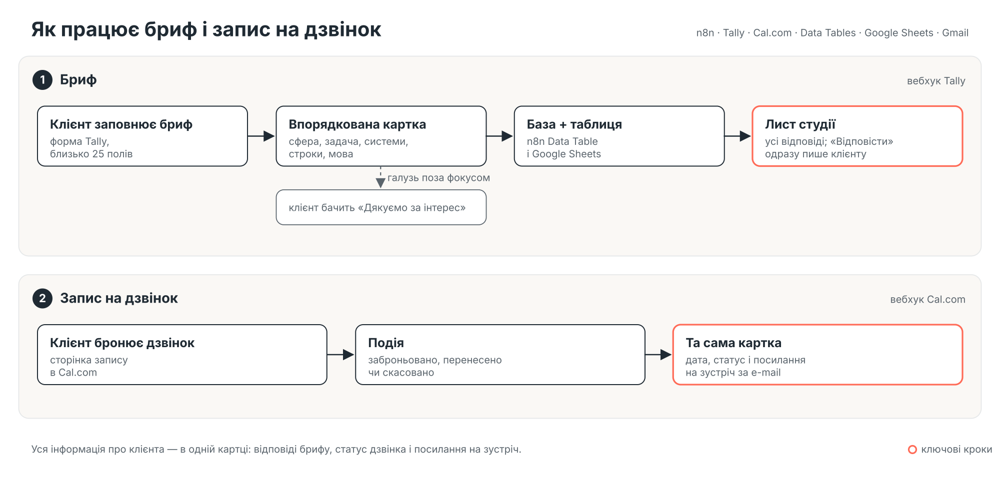
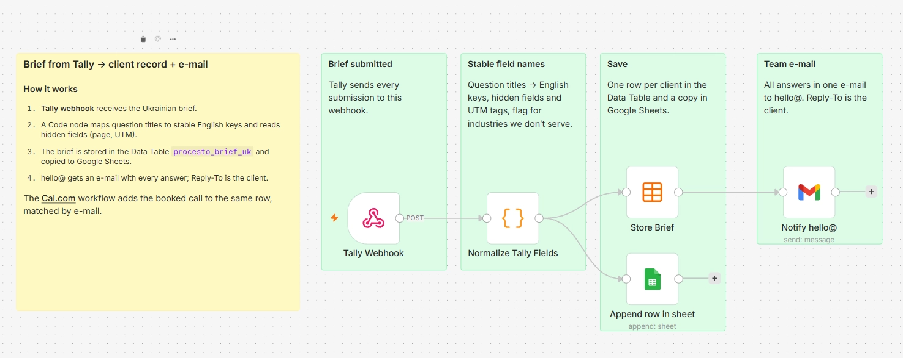
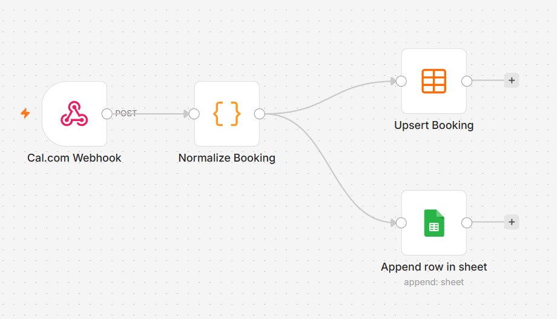

# Client Intake & Call Booking Sync · n8n

**Tally brief → data table + Google Sheet → team e-mail → Cal.com booking lands in the same client row.**

This is the intake flow Procesto runs for its own clients. It is shown here as a working reference you can import and adapt.

## The problem

A new client fills in a brief, then books a call. Without automation, these two events end up in different places: form answers in one inbox, the booking in a calendar. Someone has to match them by hand before the call, and UTM data from the page the client came from is usually lost.

## What the workflows do

**01 · Tally brief intake** (`workflows/01-tally-brief-intake.json`)

1. Tally sends the submission to an n8n webhook.
2. A Code node maps question titles to stable English keys (`industry`, `email`, `goals`, ...). It also reads hidden fields: page, format, package, and `utm_*`.
3. The row is stored in an n8n Data Table and appended to a Google Sheet.
4. The team gets a plain-text e-mail with every answer. **Reply-To is set to the client's address**, so "Reply" in the inbox goes straight to the client.
5. Industries outside the studio focus are flagged (`excluded = true`) and marked in the subject line.

**02 · Cal.com booking sync** (`workflows/02-calcom-booking-sync.json`)

1. Cal.com sends booking events to a second webhook: created, rescheduled or cancelled.
2. The booking date, status and meeting link are **upserted into the same row, matched by e-mail**.
3. A copy goes to a separate `bookings` sheet tab.

Result: one row per client holds the brief, the traffic source and the call status.

## Screenshots

| Tally brief intake | Cal.com booking sync |
| --- | --- |
|  |  |

## Stack

n8n (self-hosted) · Tally · Cal.com · n8n Data Tables · Google Sheets · Gmail

## Setup

1. Import both JSON files into n8n (*Workflows → Import from file*).
2. Create a Data Table named `client_briefs` with the columns from [`docs/data-schema.md`](docs/data-schema.md). Then select it in **Store Brief** and **Upsert Booking**.
3. Create a Google Sheet with tabs `briefs` and `bookings`, with column headers in row 1. Then set its ID in both **Append row in sheet** nodes.
4. Connect credentials for Gmail and Google Sheets in n8n.
5. Replace every placeholder listed in [`.env.example`](.env.example).
6. Activate both workflows and copy their production webhook URLs:
   - **Tally:** *Integrations → Webhooks* → the brief webhook URL.
   - **Cal.com:** *Settings → Developer → Webhooks* → the booking webhook URL, with events `BOOKING_CREATED`, `BOOKING_RESCHEDULED` and `BOOKING_CANCELLED`.
7. In Tally, add hidden fields `page`, `format`, `package`, `readiness`, `utm_source`, `utm_medium`, `utm_campaign` and `utm_content`, so the values from your links reach n8n.

The form in this example is Ukrainian, so the `MAP` in **Normalize Tally Fields** matches Ukrainian question titles by prefix. Change the left side of each pair to your own question titles; the English keys can stay.

## Notes

- The Data Table is the source of truth. The Sheet is a copy for people who prefer spreadsheets.
- `raw_json` keeps the full Tally payload, in case a question is renamed later.
- No client data is included in this repository.

## License

MIT, see [LICENSE](LICENSE). Use and adapt the workflows freely.

## Want this for your team?

Procesto designs and runs automations like this for small and mid-sized businesses in the EU.
→ [Fill in a short brief](https://tally.so/r/J1lLxK?utm_source=github&utm_medium=repo&utm_campaign=portfolio&utm_content=client-intake-sync) · [procesto.eu](https://procesto.eu)
